<p align="center">
  
</p>

<h1 align="center">Waiting Paws</h1>

<p align="center">
  Separation training for dogs on iPhone, Mac and Windows<br>
  <a href="README.ru.md">Читать по-русски</a>
</p>

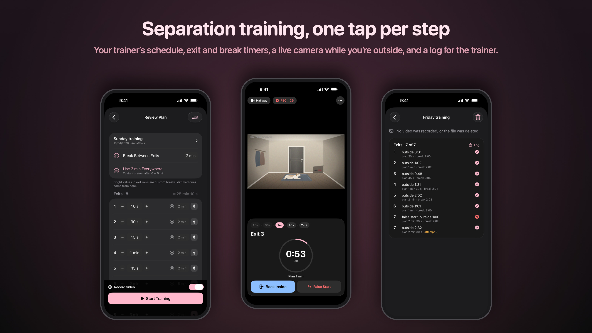

Teaching a dog to stay home alone takes many short practice exits: leave for 10 seconds, come back, wait two minutes,
leave for 30 seconds… A trainer sends the schedule, and you are left juggling a stopwatch, the chat with the schedule
and a camera app, then writing down for the trainer how it went.

Waiting Paws does all of that in one place. Paste the schedule, press one big button per step, watch the dog on the
camera while you are behind the door, and send the trainer a ready log afterwards.

## How it works

1. **Paste the schedule** your trainer sent. The app understands exits and their durations, "or until the dog stands
   up", breaks after a particular exit or for all of them, in English or Russian:

   ```
   Sunday training - Anna/Mark - 25.10.2026
   All breaks 2 minutes
   Exit 1 - 5 seconds
   Exit 2 - 10 seconds
   Break 5 minutes
   Exit 3 - 30 seconds OR until the dog stands up
   ```

   Check the exits before the start: any exit or break can be changed with a tap.
2. **Start Exit**: walk to the door, the timer is running.
3. **Outside**: a countdown to the planned time, and the live camera shows the dog. Going over the plan is highlighted.
4. **Back Inside**: the break counts down, and the next exit starts by itself when it's over. If the dog got up or
   barked too early, **False Start** repeats the same exit after a break.
5. After the last exit the training is saved together with its video, and the **log for the trainer** is ready to send:

   ```
   Sunday training · Anna/Mark
   10/25/2026, 6:00 PM–6:13 PM (13 min) · exits 3 of 3 · false starts 1

   Exit 1 — 5 s: outside 0:05 ✅ · break 2:04
   Exit 2 — 10 s: false start, outside 0:03 ❌ · break 1:00 (plan 5 min)
   Exit 2 — 10 s, attempt 2: outside 0:11 ✅ · break 5:02
   Exit 3 — 30 s or until the dog stands: outside 0:30 ✅
   ```

## Features

- **The trainer's schedule, read for you.** Paste it from Telegram, WhatsApp or notes and fix anything before the start.
- **One big button per step.** Exit and break timers, overrun warnings, the next exit starts on its own, false starts
  are counted as attempts.
- **Live camera** while you are outside: full screen, pinch to zoom. Picture quality and the camera's own settings
  (night mode, image flip, status light and whatever else the model supports) are right in the app.
- **Video recording** of every training, or a recording without one. Saved as a regular MP4 with sound, ready to share;
  on iPhone also copied to Photos.
- **A log for the trainer**: one line per attempt, in the trainer's notation, sent as plain text.
- **History** of trainings with their videos and logs. On Mac and Windows: a progress chart, a table of all trainings
  and "jump to the exit" in the video.
- **iPhone and a computer together.** Leave the Mac or PC with the camera and take the iPhone outside: it shows the
  computer's camera and drives the same training. The link works over your home network and is encrypted end to end;
  the first connection is approved on the computer.
- **Works without a camera**: timers, schedules and logs only.
- English and Russian.

## Screenshots

<table>
  <tr>
    <td align="center">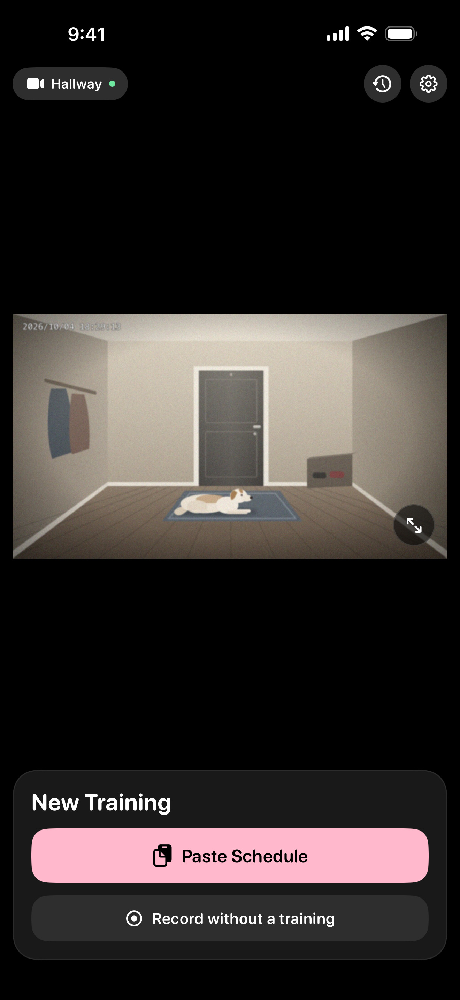<br>Start a training</td>
    <td align="center">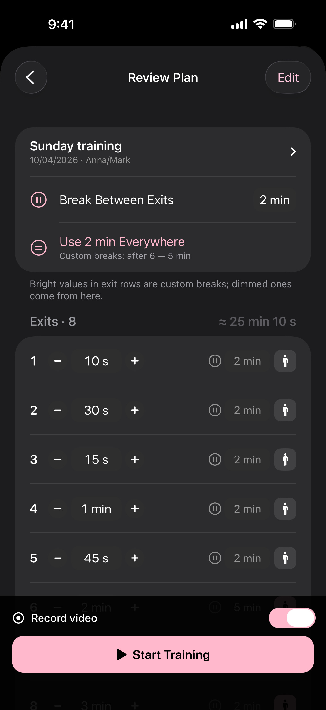<br>Review the schedule</td>
    <td align="center">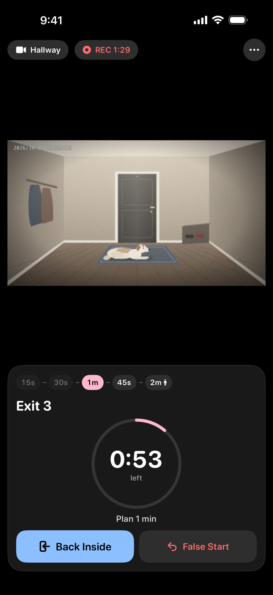<br>Outside, with the camera</td>
    <td align="center">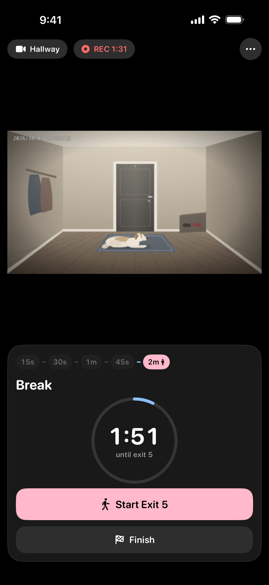<br>Break until the next exit</td>
  </tr>
  <tr>
    <td align="center">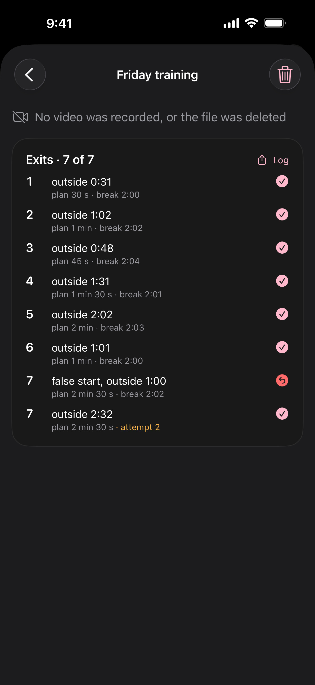<br>Log for the trainer</td>
    <td align="center">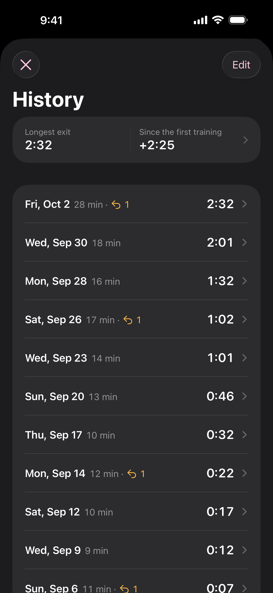<br>History</td>
    <td align="center">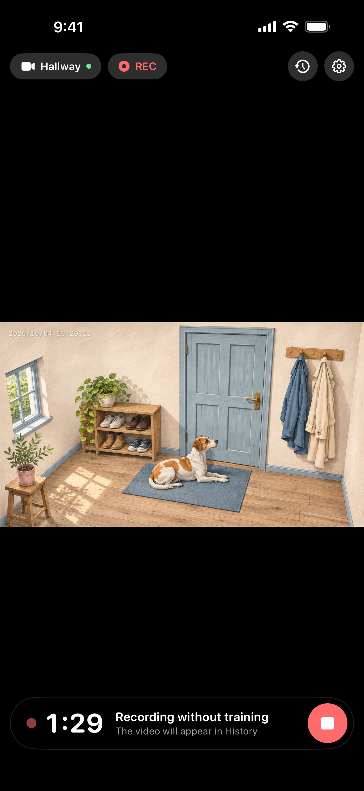<br>Recording only</td>
    <td align="center">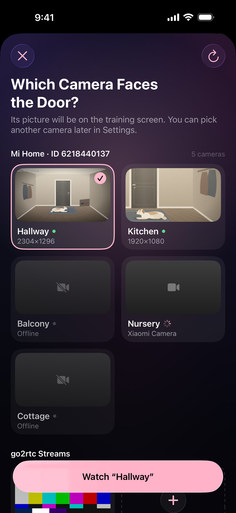<br>Pick the camera</td>
  </tr>
</table>

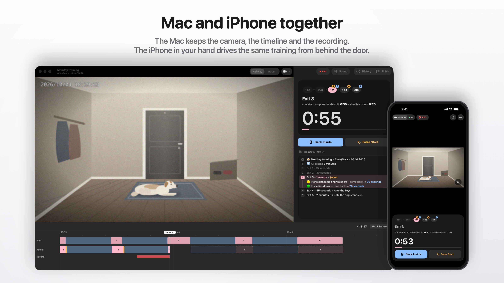

<table>
  <tr>
    <td align="center">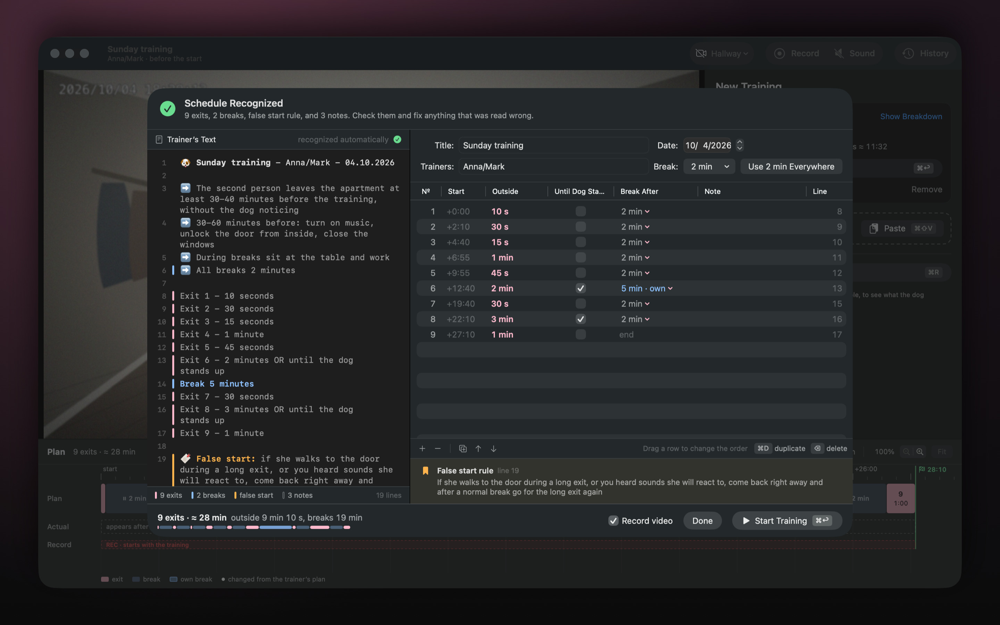<br>The trainer's text and the recognized exits</td>
    <td align="center">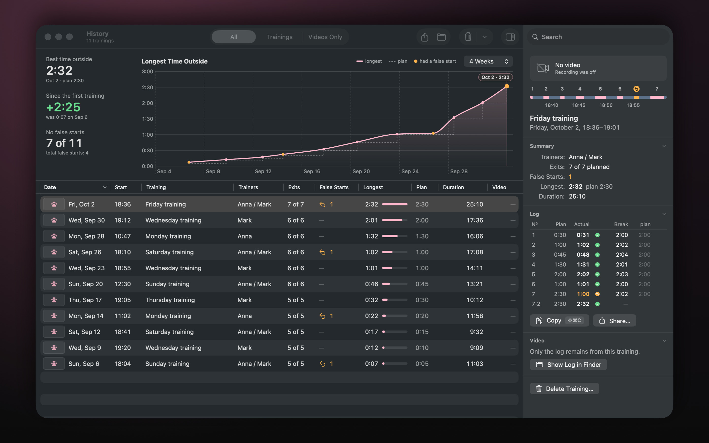<br>Progress, history and the log</td>
  </tr>
  <tr>
    <td align="center">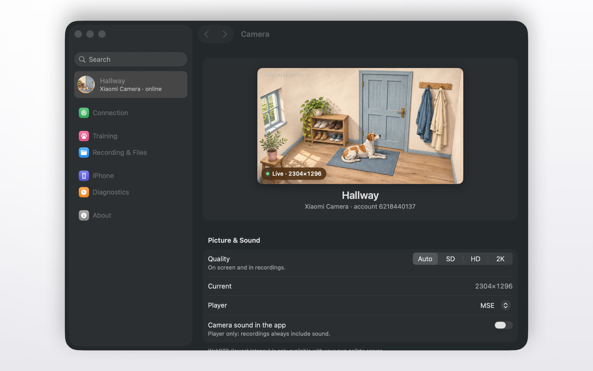<br>Camera quality and settings</td>
    <td align="center">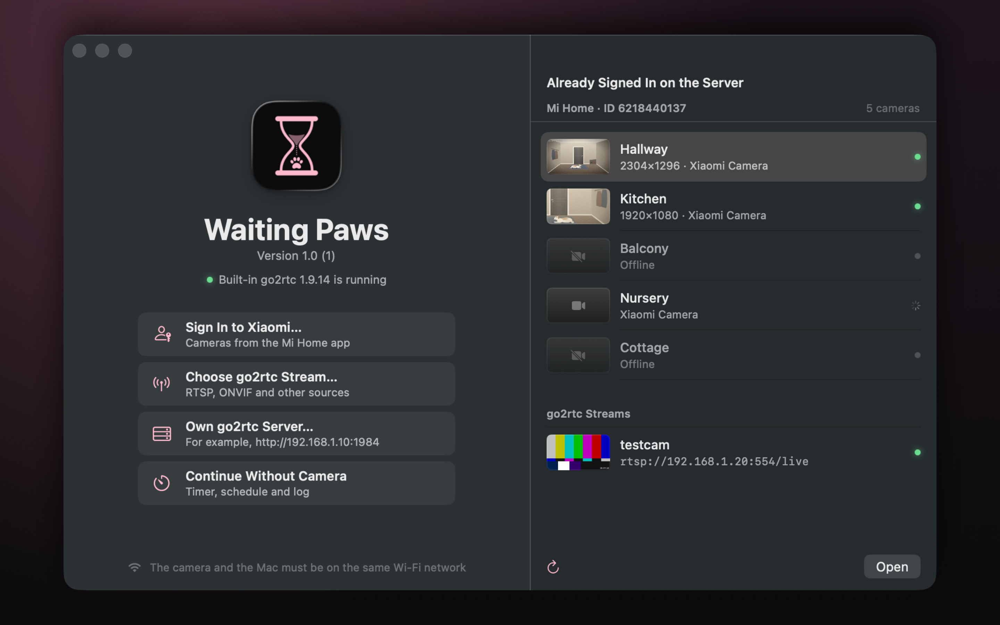<br>Setup: Xiaomi account, other cameras, or no camera</td>
  </tr>
</table>

## Cameras

- **Xiaomi (Mi Home) cameras**: sign in with your Xiaomi account right in the app (password, then the code from the
  SMS or e-mail) and pick the camera that faces the door. Cameras of homes shared with your account are listed too.
  Tested with the Xiaomi C200 and C302.
- **Other cameras**: any camera with an RTSP stream. Anything else that [go2rtc](https://github.com/AlexxIT/go2rtc)
  supports (ONVIF and more) works through your own go2rtc server.
- The camera and your phone or computer must be on the same Wi-Fi network: the video goes straight over it.
- The iPhone app shows and records video while it is open. In the background the recording pauses and continues when
  you come back.

## Install

### Windows

Download the latest version from [Releases](https://github.com/AndrewAndreev/WaitingPaws/releases/latest):

- `WaitingPaws-<version>-Setup.exe`: the installer. It installs for all users and adds Windows Firewall rules, so the
  camera and the iPhone link work on private networks.
- `WaitingPaws-<version>-win-x64.zip`: the portable version. Unpack it and run `Waiting Paws.exe`; allow access on
  private networks when Windows asks.

Windows 10 or 11, 64-bit. The app is not code-signed yet, so on the first launch SmartScreen says "Windows protected
your PC": choose **More info → Run anyway**.

### iPhone and Mac

**Coming soon to the App Store**: one app for iPhone (iOS 17 or later) and Mac (macOS 26 or later).

Until then you can build it from source with Xcode, see [DEVELOPMENT.md](DEVELOPMENT.md).

## Privacy

No accounts, no analytics, no ads, no tracking and no servers of our own. Settings, logs and videos stay on your
devices. The Xiaomi sign-in goes from the app straight to Xiaomi; the password is not stored. See the
[privacy policy](App/Resources/Legal/PrivacyPolicy-en.md).

## Feedback

Questions, ideas and bug reports: [Issues](https://github.com/AndrewAndreev/WaitingPaws/issues). Security problems:
please report them privately, see [SECURITY.md](SECURITY.md).

## For developers

- [ARCHITECTURE.md](ARCHITECTURE.md): how the iPhone and Mac apps work inside (embedded go2rtc, recording, the iPhone
  link, files), in Russian.
- [DEVELOPMENT.md](DEVELOPMENT.md): building, project layout, localization, tests, diagnostics, demo mode, in Russian.
- [GoMobile/README.md](GoMobile/README.md): the embedded go2rtc and its patches, in Russian.
- [Desktop/README.md](Desktop/README.md): the Windows app.

## License

The code is under the [MIT license](LICENSE). The Waiting Paws name and the app icon are not covered by it: forks and
redistributed builds need their own name and icon. The icon is concept 07 "Hourglass" in any rendering, including
`App/Resources/Assets.xcassets/AppIcon.appiconset/` and `AppIconImage.imageset/`, `Design/app-icon/`,
`Design/logos-v2/**/07-hourglass*`, `Desktop/build/icon.*`, `Desktop/resources/icon.png` and
`Desktop/src/renderer/src/assets/logo.svg`.

go2rtc and other third-party code keep their own licenses: `App/Resources/Legal/Acknowledgements.txt`,
`Desktop/build/ThirdPartyNotices-desktop.txt`.

Not affiliated with, endorsed or sponsored by Xiaomi. "Xiaomi" and "Mi Home" are trademarks of their owners. Like
go2rtc and Home Assistant, the app uses Xiaomi's cloud API to sign in to your own account, list its cameras and change
their settings; the video itself goes over your local network.
