<p align="center">
  
</p>

<h1 align="center">Waiting Paws</h1>

<p align="center">
  Тренировка коротких выходов из дома с собакой на iPhone, Mac и Windows<br>
  <a href="README.md">Read in English</a>
</p>


Чтобы собака спокойно оставалась дома одна, нужно много коротких тренировочных выходов: выйти на 10 секунд, вернуться,
подождать две минуты, выйти на 30 секунд… Тренер присылает расписание, а дальше приходится одновременно следить за
секундомером, перепиской с расписанием и приложением камеры, а потом ещё записывать для тренера, как всё прошло.

Waiting Paws собирает это в одном месте. Вставьте расписание, нажимайте одну крупную кнопку на каждый шаг, смотрите на
собаку через камеру, пока вы за дверью, и отправьте тренеру готовый лог.

## Как это работает

1. **Вставьте расписание** от тренера. Приложение понимает выходы и их длительность, «или до вставания», перерывы после
   конкретного выхода или для всех сразу, триггеры выхода («+ куртка», «+ взять ключи») и условия раннего входа
   («🟡 Если встала и пошла — входим через 2 минуты»), по-русски и по-английски:

   ```
   Тренировка на воскресенье - Анна/Марк - 25.10.2026
   Все перерывы 2 минуты
   1 выход - 5 секунд
   2 выход - 10 секунд + куртка
   Перерыв 5 минут
   3 выход - 3 минуты ИЛИ до вставания
   🟡 Если встала и пошла - входим через 1 минуту от начала движения
   🟢 Если легла - входим через 20 секунд от укладки
   ```

   Условия прямо под выходом — его собственные, написанные один раз для всей тренировки можно отдать всем выходам или
   только длинным. Перед стартом проверьте выходы: любой выход и перерыв меняется одним касанием, а под каждым выходом
   видно ⚡ триггеры, 🏃 условия раннего входа и 📝 заметку — их можно поправить для этого выхода. Поправить расписание можно и во
   время тренировки — например, если все перерывы на самом деле длиннее, чем прочитало приложение: на Mac прямо на
   таймлайне (щёлкните выход или перерыв и впишите длительность или тяните его край; с ⇧ — по 5 с) или через
   «Расписание…», на iPhone — ••• → «Изменить расписание». Таймеры сразу пересчитываются.
2. Две кнопки, одинаковые на iPhone и Mac. **Вышли** — когда дверь за вами закрылась: обратный отсчёт до плана,
   камера показывает собаку. Перебор подсвечивается. Под таймером — когда войти раньше («Встала и пошла — через
   2:00», «Легла — через 0:40») и когда не входить; в перерыве — что взять на следующий выход. Весь текст тренера
   открывается прямо на экране тренировки, камера при этом не переподключается.
3. **Вернулись** — идёт отсчёт перерыва до следующего выхода. Если перерыв затянулся, таймер желтеет и считает
   вверх — видно, сколько он длился на самом деле. Если собака встала или залаяла раньше времени — или пошла к
   двери во время перерыва, — **Фальстарт** повторит тот же выход после перерыва.
4. После последнего выхода тренировка сохраняется вместе с видео, и готов **лог для тренера**:

   ```
   Тренировка на воскресенье · Анна/Марк
   25.10.2026, 18:00–18:13 (13 мин) · выходов 3 из 3 · фальстартов 1

   1 выход — 5 с: за дверью 0:05 ✅ · перерыв 2:04
   2 выход — 10 с: фальстарт, за дверью 0:03 ❌ · перерыв 1:00 (план 5 мин)
   2 выход — 10 с, попытка 2: за дверью 0:11 ✅ · перерыв 5:02
   3 выход — 30 с или до вставания: за дверью 0:30 ✅
   ```

## Возможности

- **Расписание тренера разбирается само.** Вставьте его из Telegram, WhatsApp или заметок и поправьте перед стартом.
- **Одна крупная кнопка на каждый шаг.** Таймеры выходов и перерывов, подсветка перебора, следующий выход начинается
  сам, фальстарты считаются попытками.
- **Живая камера**, пока вы за дверью: во весь экран, с приближением щипком. Можно добавить вторую камеру
  (например, в комнату) и переключаться между ними без переподключения. На iPhone и Mac запись идёт с камеры на
  экране, на Windows — с первой. Качество картинки и настройки самой камеры (ночной режим, поворот изображения,
  индикатор и всё, что поддерживает модель) — прямо в приложении.
- **Запись видео** каждой тренировки или просто запись без тренировки. Обычный MP4 со звуком, который можно сразу
  отправить; на iPhone он ещё и копируется в «Фото».
- **Лог для тренера**: строка на каждую попытку в нотации расписания, отправляется обычным текстом.
- **История** тренировок с видео и логами. На Mac и Windows — график прогресса, таблица всех тренировок и переход к
  нужному выходу в видео.
- **iPhone и компьютер вместе.** Оставьте Mac или ПК с камерой, а iPhone возьмите с собой за дверь: он показывает
  камеру компьютера и ведёт ту же тренировку. Связь идёт по домашней сети, первое подключение разрешается на
  компьютере. Сопряжение, тренировка и её команды зашифрованы; видео, звук и управление камерой идут без шифрования,
  их защищает только пароль.
- **Работает и без камеры**: только таймеры, расписание и лог.
- Русский и английский языки.

## Скриншоты

<table>
  <tr>
    <td align="center">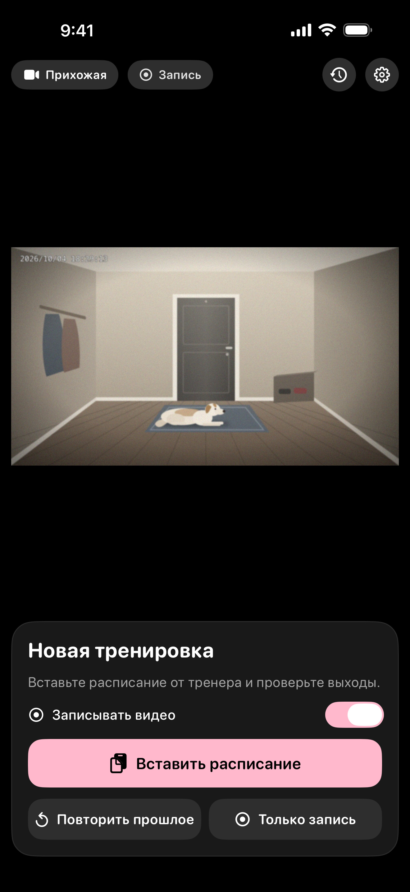<br>Новая тренировка</td>
    <td align="center">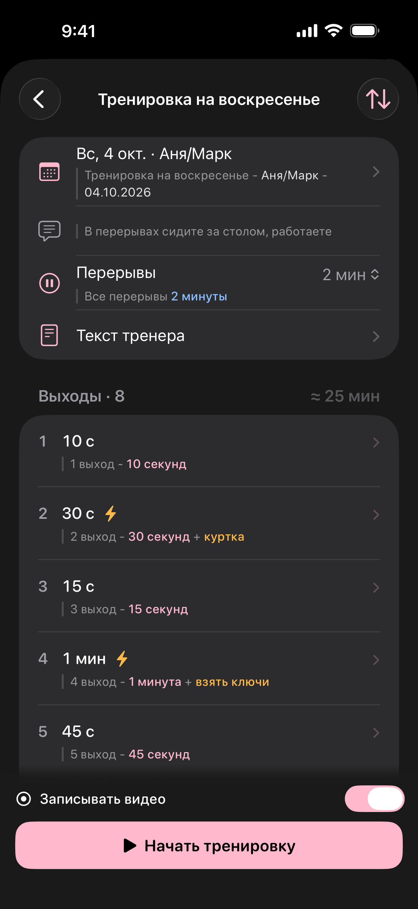<br>Проверка расписания</td>
    <td align="center">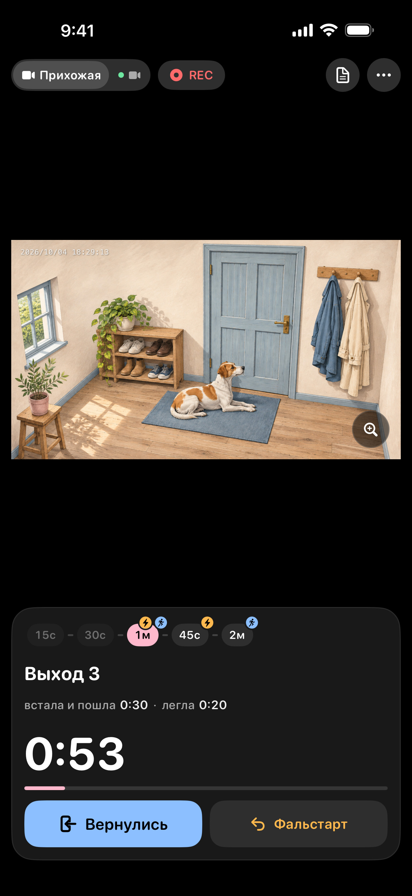<br>За дверью, с камерой</td>
    <td align="center">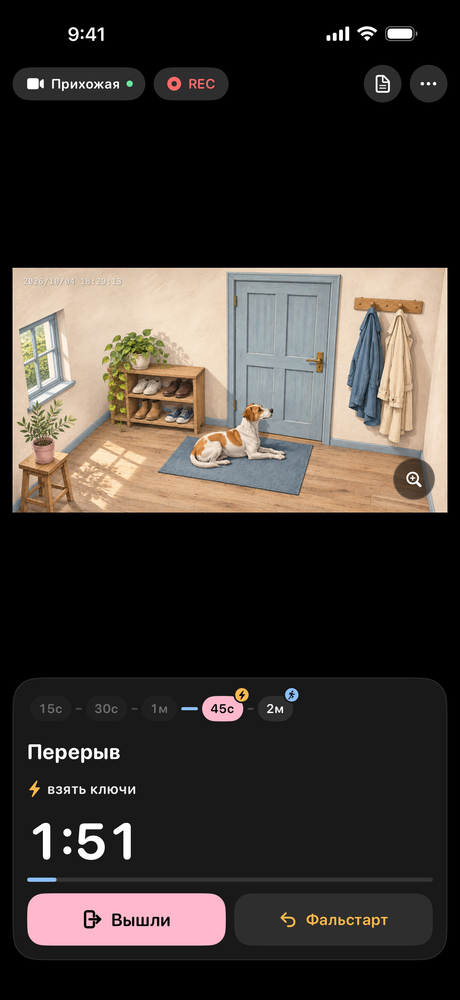<br>Перерыв до следующего выхода</td>
  </tr>
  <tr>
    <td align="center">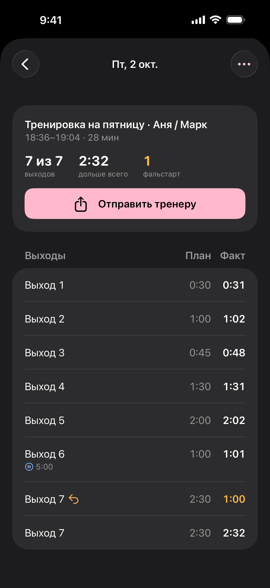<br>Лог для тренера</td>
    <td align="center">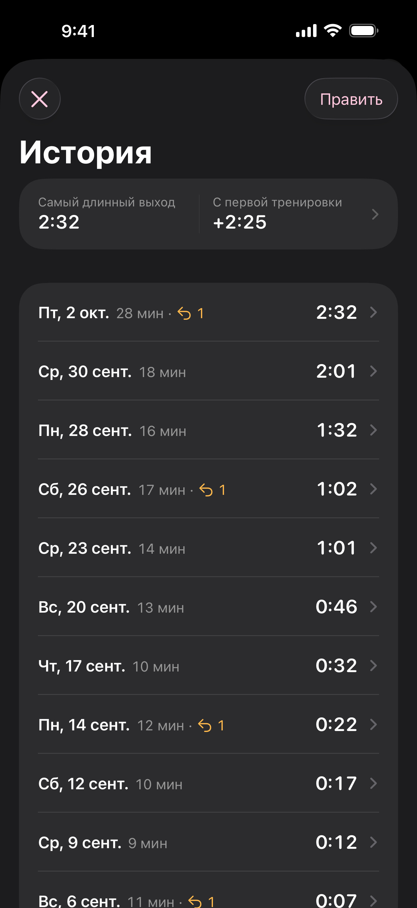<br>История</td>
    <td align="center">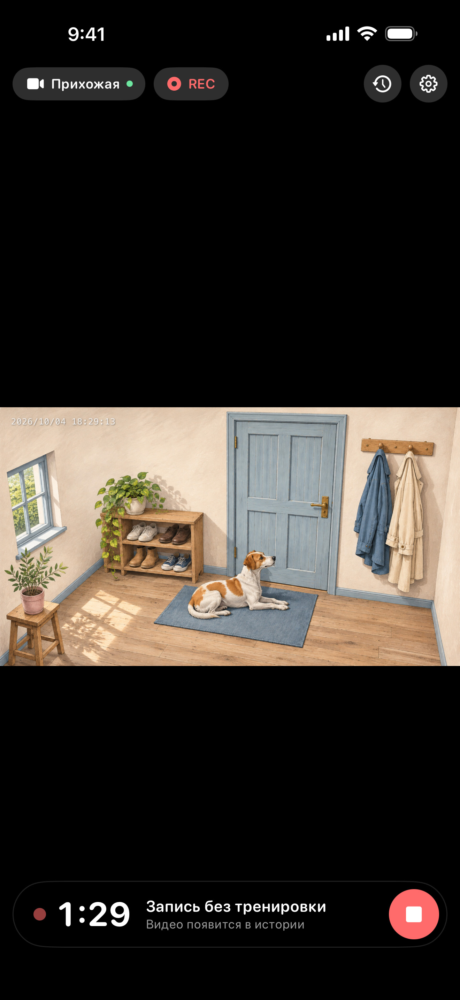<br>Только запись</td>
    <td align="center">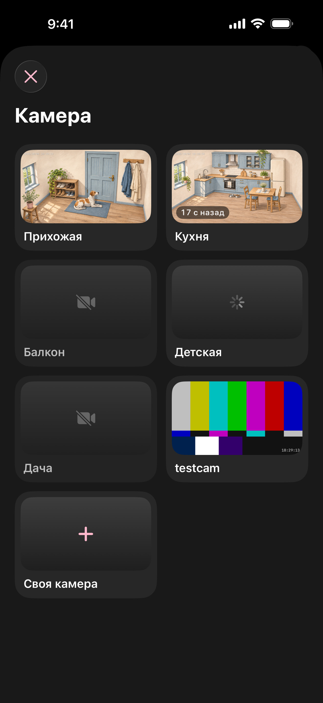<br>Выбор камеры</td>
  </tr>
</table>

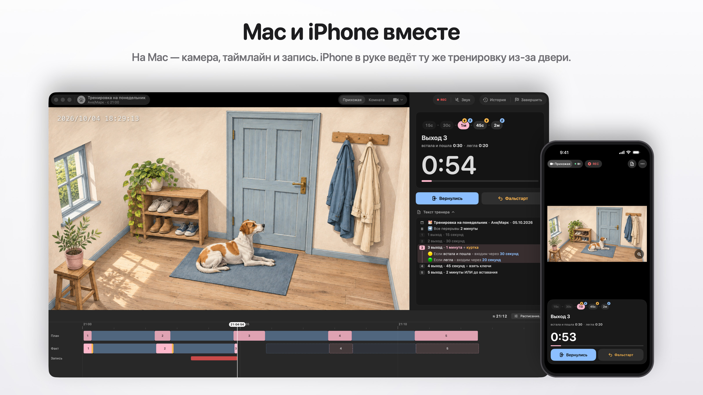

<table>
  <tr>
    <td align="center">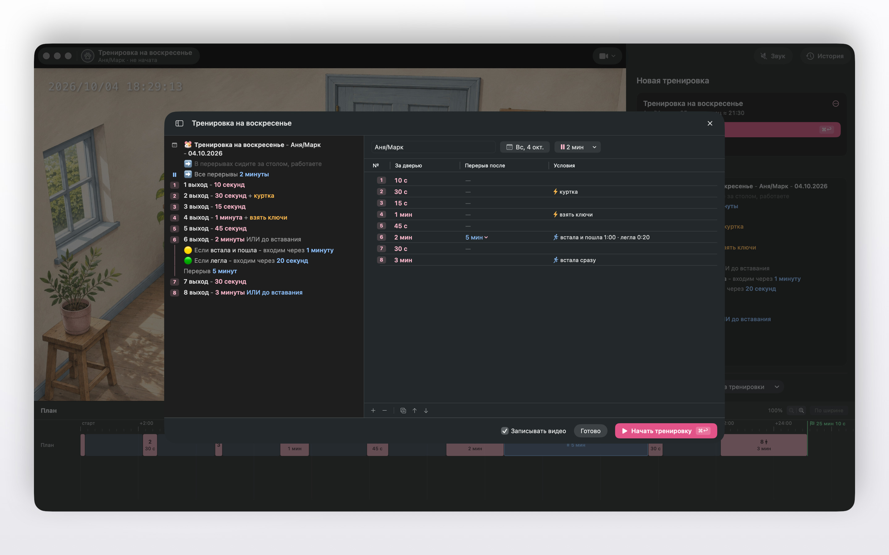<br>Текст тренера и распознанные выходы</td>
    <td align="center">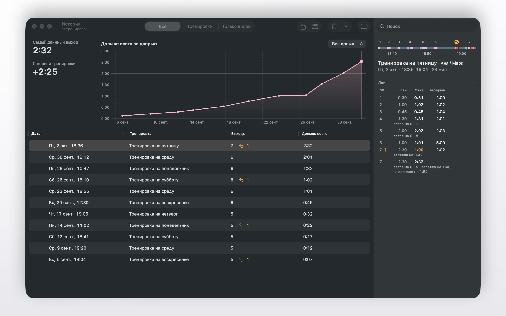<br>Прогресс, история и лог</td>
  </tr>
  <tr>
    <td align="center">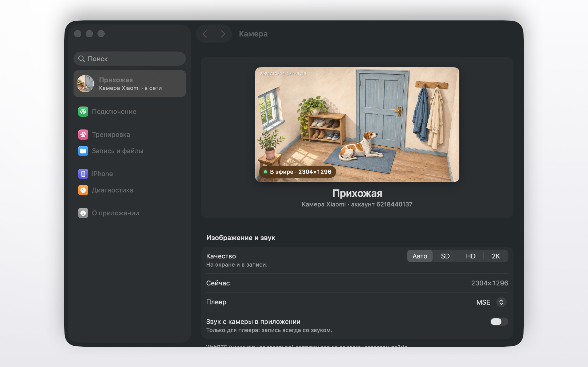<br>Качество и настройки камеры</td>
    <td align="center">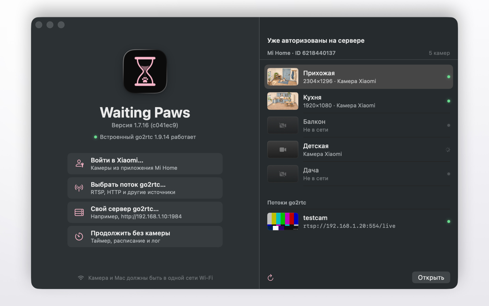<br>Начало: аккаунт Xiaomi, другие камеры или без камеры</td>
  </tr>
</table>

## Камеры

- **Камеры Xiaomi (Mi Home)**: войдите в аккаунт Xiaomi прямо в приложении (пароль, затем код из SMS или письма) и
  выберите камеру, которая смотрит на дверь. Камеры домов, к которым вашему аккаунту дали общий доступ, тоже видны.
  Проверено на Xiaomi C200 и C302.
- **Другие камеры**: любая камера с потоком RTSP или HTTP работает со встроенным go2rtc. ONVIF и всё остальное, что
  поддерживает [go2rtc](https://github.com/AlexxIT/go2rtc), работает через ваш собственный сервер go2rtc.
- Камера и телефон или компьютер должны быть в одной сети Wi-Fi: видео идёт напрямую по ней.
- Приложение на iPhone показывает и записывает видео, пока оно открыто. В фоне запись приостанавливается и продолжается,
  когда вы вернётесь в приложение.

## Установка

### Windows

Скачайте последнюю версию в [Releases](https://github.com/AndrewAndreev/WaitingPaws/releases/latest):

- `WaitingPaws-<версия>-Setup.exe` — установщик. Ставит приложение для всех пользователей и добавляет правила
  брандмауэра Windows, чтобы камера и связь с iPhone работали в частных сетях.
- `WaitingPaws-<версия>-win-x64.zip` — переносная версия. Распакуйте и запустите `Waiting Paws.exe`; когда Windows
  спросит, разрешите доступ в частных сетях.

Windows 10 или 11, 64-бит. Приложение пока не подписано, поэтому при первом запуске SmartScreen пишет «Система Windows
защитила ваш компьютер»: нажмите **Подробнее → Выполнить в любом случае**.

### iPhone и Mac

**Скоро в App Store**: одно приложение для iPhone (iOS 17 и новее) и Mac (macOS 26 и новее).

А пока его можно собрать из исходников в Xcode, см. [DEVELOPMENT.md](DEVELOPMENT.md).

## Приватность

Без аккаунта Waiting Paws, аналитики, рекламы, отслеживания и собственных серверов. Настройки, логи и видео остаются на ваших
устройствах. Вход в Xiaomi идёт из приложения напрямую в Xiaomi, пароль не сохраняется. Подробнее — в
[политике конфиденциальности](App/Resources/Legal/PrivacyPolicy-ru.md).

## Обратная связь

Вопросы, идеи и ошибки — в [Issues](https://github.com/AndrewAndreev/WaitingPaws/issues). Об уязвимостях, пожалуйста,
сообщайте приватно, см. [SECURITY.md](SECURITY.md).

## Разработчикам

- [ARCHITECTURE.md](ARCHITECTURE.md) — как устроены приложения для iPhone и Mac: встроенный go2rtc, запись, связь с
  iPhone, файлы.
- [DEVELOPMENT.md](DEVELOPMENT.md) — сборка, структура проекта, локализация, тесты, диагностика, демо-режим.
- [GoMobile/README.md](GoMobile/README.md) — встроенный go2rtc и его патчи.
- [Desktop/README.md](Desktop/README.md) — приложение для Windows (на английском).
- `Design/` — дизайн-лаборатории и черновики логотипа, в сборку приложений не входят.

## Лицензия

Код — под [лицензией MIT](LICENSE). Название «Waiting Paws» и иконка приложения под неё не входят: форки и сборки,
которые распространяются дальше, должны называться иначе и иметь свою иконку. Иконка — концепт 07 «Песочные часы» в
любом виде, в том числе `App/Resources/Assets.xcassets/AppIcon.appiconset/` и `AppIconImage.imageset/`,
`Design/app-icon/`, `Design/logos-v2/**/07*`, `Design/logos-v2/sheets/`, `Desktop/build/icon.*`,
`Desktop/resources/icon.png` и `Desktop/src/renderer/src/assets/logo.svg`.

go2rtc и остальной сторонний код — под своими лицензиями: `App/Resources/Legal/Acknowledgements.txt`,
`Desktop/build/ThirdPartyNotices-desktop.txt`.

Apple, iPhone, Mac и App Store — товарные знаки Apple Inc.

Проект не связан с Xiaomi и не одобрен ею; «Xiaomi» и «Mi Home» — товарные знаки их владельцев. Как go2rtc и Home
Assistant, приложение использует облачный API Xiaomi, чтобы войти в ваш аккаунт, получить список его камер и менять их
настройки; само видео идёт по вашей локальной сети.
